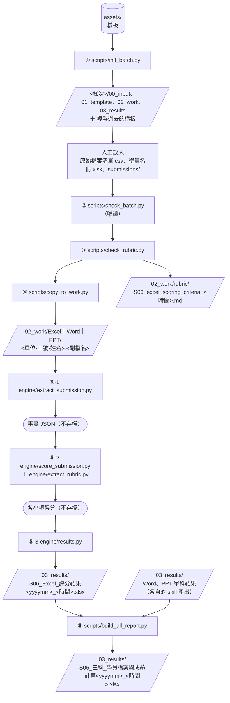
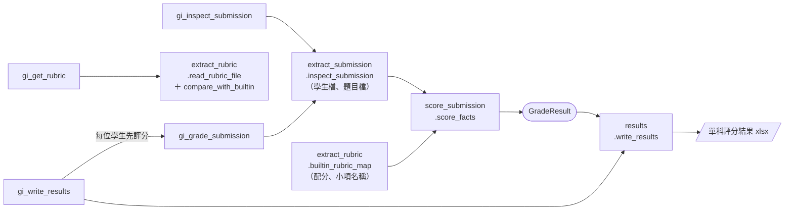

# 04 — excel-grading

「S06 Excel實作」考題評分 SOP skill，批改「薪資樞紐分析 / 成績表 / 車輛銷售
直條圖 / 武將能力雷達圖」四大題、共18個小項的學生 .xlsx 作答檔，並把結果寫進
標準格式的『單科評分結果』活頁簿；也附有梯次資料夾的建立、檢查、複製與三科彙總腳本。

來源：從 `s06-excel-grading_v0.1.skill`（Claude skill 打包檔）解壓匯入。

## 這是什麼

一份可安裝進 Claude 的 skill，內建評閱標準比對邏輯、樞紐表/圖表/凍結窗格等
技術檢查方法、常見錯誤案例，以及「單科評分結果」活頁簿（評分細項 + 評分結果表）的固定
輸出格式。

## 如何使用

1. 用 repo 根目錄的 `python tools/build_skill.py 04 --name excel_grading_v1` 打包成
   `dist/excel_grading_v1.skill`，或將整個 repo clone 下來，把此資料夾當作 skill 目錄使用。
   打包後預設也會把本資料夾的檔案（排除 `.venv`、`__pycache__`、`local_config.json`、02_work
   作業檔，保留 `.gitignore`）複製到 `skill.toml` `[publish] copy_to` 指定的
   `D:\【git_rjsiao】\git_skill\s06_evaluation\excel_eval\`，再到那個 repo commit。只覆寫有變動的
   檔案、不刪除目的地的檔案；那個資料夾在這台機器上不存在時只打包。`--no-copy` 只打包，
   `--copy-to <資料夾>` 改複製到別處。
2. 在 Claude 中安裝（Save skill）。
3. 上傳一份或多份「部門代號-工號-姓名.xlsx」學生作答檔，並提到評分/批改
   「S06」或「Excel實作」，會自動觸發此 skill。

在本機處理整個梯次時（Claude Code），流程見下一節「運作流程與產出檔案」；各腳本的
參數見 `SKILL.md` 的工具表。

## 運作流程與產出檔案

梯次資料夾是 `<資料根目錄>/grading/training_internal/S06_<yyyymm>/`（資料根目錄依序取
`--root`、`scripts/local_config.json` 的 `data_root`、預設 `D:\claude_data`），以下用
`<梯次>` 代表。所有 scripts 都從 `skill.toml` 讀 `course_code`（S06）與 `domain`。



`<時間>` 一律是執行當下的 `yyyymmdd_HHMMSS`。

| 步驟 | 程式 | 讀取 | 產出（寫入位置） |
|---|---|---|---|
| ① 建立梯次 | `scripts/init_batch.py --batch <yyyymm>` | `assets/` 整個目錄、`skill.toml` | 建立 `<梯次>/` 的 00_input（manifest_source、roster、submissions）、01_template、02_work（Excel、Word、PPT）、03_results，並把 `assets/` 的樣板複製到同名資料夾（評閱標準、題目、答案、`temp_` 開頭的清單／名冊／結果樣板）。已存在的檔案不覆寫，`.gitkeep` 不複製 |
| （人工） | — | — | `00_input/manifest_source/S06_三科_原始檔案<yyyymm>[_<時間>].csv`、`00_input/roster/S06_三科_學員名冊<yyyymm>.xlsx`、`00_input/submissions/<單位-工號-姓名>/` 底下的作業檔 |
| ② 評分前檢查 | `scripts/check_batch.py --batch <yyyymm>` | 上面三種輸入、`01_template/`、`02_work/`、`03_results/` | 無，只在終端機列出六項檢查結果（exit code 0＝全部通過） |
| ③ 評閱標準一致性 | `scripts/check_rubric.py --batch <yyyymm>` | `<梯次>/01_template/` 最新版本的評閱標準、標準解答檔、題目檔；`references/scoring_checks.md`；`engine/` | `02_work/rubric/S06_excel_scoring_criteria_<時間>.md`（每次執行新增一份，不覆寫舊的；資料夾不存在會建立） |
| ④ 複製合規作業 | `scripts/copy_to_work.py --batch <yyyymm>` | `00_input/submissions/`、學員名冊 | `02_work/Excel/`、`02_work/Word/`、`02_work/PPT/` 底下的 `<單位-工號-姓名>.<副檔名>`（只複製合規檔案；02_work 已有同名檔不覆寫；壓縮檔不解壓、只列出） |
| ⑤-1 萃取事實 | `engine/extract_submission.py`（可直接執行，也被 engine 呼叫） | `02_work/Excel/<學生檔案>`、`01_template/` 的題目檔（`--question`） | 無檔案；直接執行時把 JSON 印到終端機，engine 呼叫時回傳 dict |
| ⑤-2 計分 | `engine/score_submission.py`（用 `engine/extract_rubric.py` 的內建配分表） | ⑤-1 的事實 | 無檔案；回傳各小項得分、評閱結果說明、`needs_review`、warnings |
| ⑤-3 寫結果 | `engine/results.py`（MCP 的 `gi_write_results` 呼叫） | 結果樣板 `temp_S06_單科_評分結果yyyymm_v1.xlsx`，或要追加的既有結果檔 | `03_results/S06_Excel_評分結果<yyyymm>_<時間>.xlsx`（活頁1 評分細項、活頁2 評分結果表；梯次資料夾不存在時存到 MCP server 的 output 資料夾）。純 skill 使用時由模型依 SKILL.md 第3、4步用 openpyxl 寫出同樣格式 |
| ⑥ 三科彙總 | `scripts/build_all_report.py --batch <yyyymm>` | 原始檔案清單、學員名冊、`00_input/submissions/`（算 SHA256）、`03_results/` 的三科單科結果（每科取最新一份）、三科彙總樣板 | `03_results/S06_三科_學員檔案與成績計算<yyyymm>_<時間>.xlsx`（活頁 manifest、score）。輸入檔只讀 |

engine 內部的呼叫關係（MCP server 透過 `engine/__init__.py` 的 `ENGINE` 使用）：



MCP server 本身另外會寫稽核 log（`<output>/_audit/<server>.jsonl`），見 `mcp-server/README.md`。

注意事項：
- **02_work 評分前必須淨空**：`check_batch.py` 只檢查 `02_work/Excel｜Word｜PPT`；`02_work/rubric/`
  的一致性報告不影響這項檢查。
- **評閱標準以梯次 01_template 為準**：③ 比對梯次裡最新版本的評閱標準；MCP 的 ⑤ 用的是
  `skill.toml` 指定、放在本 skill `assets/` 的那份，③ 會檢查兩者內容是否相同。
- **三科彙總只讀單科結果**：⑥ 依「工號＋姓名」對應學生，單科結果超過 100 分在彙總時才封頂。

## 目錄結構

```
04-excel-grading/
├── README.md                                      # 本說明文件
├── SKILL.md                                       # skill核心邏輯（給Claude讀）
├── skill.toml                                     # 中繼資料（domain、課程代碼、engine、assets）；MCP server 與 scripts 讀取
├── requirements.txt                               # Python 依賴（openpyxl）
│
├── assets/                                        # 梯次資料夾的樣板（init_batch.py 複製到 <梯次>/）
│   ├── 00_input/                                  # manifest_source、roster（各有一份 temp_ 樣板）、submissions（空資料夾）
│   ├── 01_template/
│   │   ├── S06_excel_scoring_criteria_v1.xlsx     # 評閱標準（唯一評分依據）
│   │   ├── S06_excel_question_v1.xlsx             # 原始題目檔（未作答，用來比對是否被更動）
│   │   └── S06_excel_answer_v1.xlsx               # 標準解答檔（參考用，非逐格diff依據）
│   ├── 02_work/                                   # Excel、Word、PPT（copy_to_work.py 複製合規檔案到這裡）
│   └── 03_results/
│       ├── temp_S06_單科_評分結果yyyymm_v1.xlsx           # 單科評分結果樣板（評分細項＋評分結果表）
│       └── temp_S06_三科_學員檔案與成績計算yyyymm_v1.xlsx  # 三科彙總樣板（manifest＋score）
│
├── references/
│   └── scoring_checks.md                          # 逐小項技術檢查方法、常見錯誤案例
│
├── engine/                                        # 評分引擎（xlsx_s06），mcp-server 依 skill.toml 載入
│   ├── extract_submission.py                      # 讀取學生檔案，輸出結構化 JSON（也可直接執行）
│   ├── extract_rubric.py                          # 內建配分表、讀評閱標準
│   ├── score_submission.py                        # 依 scoring_checks.md 規則給分
│   └── results.py                                 # 寫入單科評分結果活頁簿（評分細項＋評分結果表）
│
└── scripts/
    ├── init_batch.py                              # 建立梯次資料夾並複製樣板
    ├── check_batch.py                             # 評分前檢查梯次資料夾
    ├── copy_to_work.py                            # 合規作業檔複製到 02_work（不解壓縮）
    ├── build_all_report.py                        # 產出三科 學員檔案與成績計算（manifest＋score）
    └── check_rubric.py                            # 檢查 scoring_checks.md 與 engine 是否符合評閱標準 xlsx（比對梯次 01_template，報告寫到 02_work/rubric/）
```

## 設計原則

- **評分依據以「評閱標準」文字敘述為準**：不是拿學生檔案跟標準解答檔逐格
  diff，因為同一評分標準底下可能有多種合格的呈現方式。
- **標準的優先順序是 評閱標準 xlsx（最新版本）＞ `scoring_checks.md` ＞ `engine/` 的 py**：
  md 與 py 都照 xlsx 撰寫；三者不一致時以 xlsx 為準，修改 md 與 py。可用
  `python scripts/check_rubric.py --batch <yyyymm>` 檢查配分與關鍵數值是否一致（語意仍需人工對照）。
  評分標準裡的範圍、儲存格、標籤、門檻都寫成 engine 的具名常數（例如
  `SALARY_SOURCE_RANGE`、`FREEZE_CELL`），這支腳本就是比對這些常數。
- **`engine/extract_submission.py` 只萃取客觀事實，不計分**：樞紐表設定、圖表動態性、
  凍結窗格、合併儲存格、框線、排序/篩選、公式等。純 skill 使用時由模型依
  `scoring_checks.md` 的規則判斷得分；透過 MCP 時由 `engine/score_submission.py`
  依同一份規則計分。兩者都不必每次重新推導 XML 解析邏輯。
- **`references/scoring_checks.md` 與 `SKILL.md` 分離**：前者是逐小項的技術
  檢查細則與案例庫（內容會隨遇到的新案例增修），後者是評分流程與規則的
  進入點，分開維護避免流程文件被案例細節塞爆。

## MCP Server

同一套檢查與計分規則也以 MCP tools 形式提供：由內訓 server
`kd-grading-internal` 的 `gi_*` tools 提供，呼叫時帶 `skill="04-excel-grading"`。
詳見 repo 根目錄的 [`mcp-server/`](../../mcp-server/)。

- **`skill.toml`：** 告訴 server 本 skill 屬於 `training_internal`、接受 `xlsx`、
  由本資料夾 `engine/` 的 `xlsx_s06` engine 評分（`engine_path`），以及各 assets 檔的位置。
  `scripts/`（init_batch 等）也從這裡讀 `course_code` 與 `domain`。改檔名或新增評閱標準版本時，要同步更新這份檔案。
- **單一實作：** 評分引擎（含寫單科評分結果的 `engine/results.py`）只有 `engine/` 這一份，
  純 skill 使用（`python engine/extract_submission.py`）與 MCP server 用的是同一套程式。
  `score_submission.py`、`results.py` 依賴 `kd_mcp`，只有在 MCP server 的環境才能執行。

## 使用限制

- 不會自動判斷評閱標準的「配分」是否為最新版本，若使用者提供不同版本的
  評閱標準檔案，以使用者提供的為準。
- 不會捏造未提供素材中的技術細節或分數，資訊不足（檔名解析不出來、缺少
  必要工作表等）時會主動詢問，不會憑空帶入預設值。
- 圖表用「資料表(Data Table)」而非逐點資料標籤時（`has_data_table: true`），
  3.4 會標成需人工確認，要開 chart XML 確認。其他需人工確認的情況列在
  `references/scoring_checks.md` 開頭。
